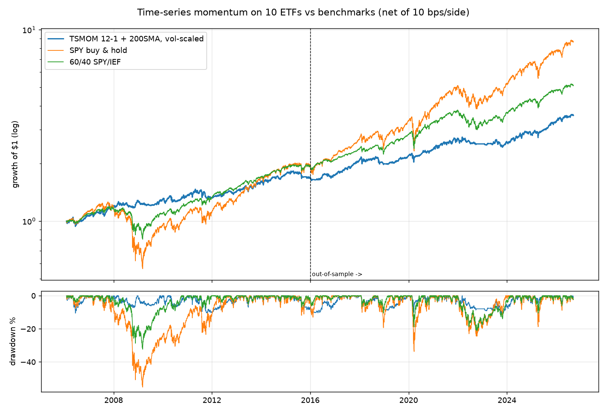

# tsmom-etf: time-series momentum on 10 ETFs, backtested and paper-traded

A systematic, long-only trend-following strategy: backtested with no look-ahead and realistic costs, validated in-sample /
out-of-sample / walk-forward, then wired to the Alpaca **paper** API with a risk manager in front of every order.
This is a research-and-engineering project first and a trading bot second. If the numbers are unflattering they stay in.

## Problem

Can a simple, fully specified, literature-based trend rule improve the *risk-adjusted* return of a diversified ETF
portfolio once you account for transaction costs, and does it hold up out of sample? Buy-and-hold SPY and a 60/40
portfolio are the bar it has to clear.

## Strategy

Time-series momentum with volatility targeting (Moskowitz, Ooi & Pedersen, 2012), applied to daily bars:

| component | rule | setting |
|---|---|---|
| universe | 10 liquid ETFs across equities, bonds, gold, commodities, real estate | `SPY QQQ IWM EFA EEM TLT IEF GLD DBC VNQ` |
| signal | **12-1 momentum**: total return over the past 12 months excluding the most recent month, long if > 0 | `MOM_LOOKBACK_MONTHS=12`, `MOM_SKIP_MONTHS=1` |
| confirmation | price above its 200-day simple moving average | `SMA_WINDOW=200` |
| sizing | **portfolio-level vol targeting**: inverse-vol base weights across the ETFs with a signal, then gross exposure scaled so the portfolio's trailing 60-day vol is 10% annualised | `SIZING="portfolio"`, `VOL_TARGET=0.10`, `VOL_WINDOW=60` |
| caps | gross exposure <= 100% (no leverage); then single position <= 20% of NAV; rest in cash at 0% | `MAX_GROSS_EXPOSURE`, `MAX_POSITION_WEIGHT` |
| rebalance | monthly: signal from the last close of the month, fills at the **next open** (first trading day) | `REBALANCE="monthly"` |
| rebalance band | a held position is only traded when its target differs from its current weight by >= 2pp; entries and exits always trade | `REBALANCE_BAND=0.02` |
| costs | 5 bps commission + 5 bps slippage **per side** on traded value | `COMMISSION_BPS`, `SLIPPAGE_BPS` |

Everything above lives in `settings.py`. The signal parameters are the paper's defaults (12-1 lookback, monthly holding)
plus a common 200-day filter, chosen before running the backtest. Two things *were* changed after looking at results, and
both are documented in the ablation table: the original per-position vol scaling (`w = 0.10 / vol`, the paper's
construction) turned out to be inert under a 20% cap and was replaced by portfolio-level targeting, and a 2pp rebalance
band was added to cut turnover. The v1 rule is still in the code (`SIZING="per_position"`) so the comparison reruns.

**Reference.** Moskowitz, T. J., Ooi, Y. H., & Pedersen, L. H. (2012). Time series momentum.
*Journal of Financial Economics*, 104(2), 228-250. https://doi.org/10.1016/j.jfineco.2011.11.003

## Data

Daily OHLCV from Yahoo Finance via `yfinance`, 2005-01-01 to the last cached bar, split- and dividend-adjusted
(`auto_adjust=True`, so close-to-close returns are total returns and the open is on the same adjusted basis).
The cache in `data/` is **committed** so that `make backtest` reproduces every number below from a clean clone with
no network; `make data` refreshes it. `data/manifest.json` records when it was pulled. DBC only lists from
2006-02 and enters the universe once it has 12 months of history; nothing else is missing.

## Method

- **No look-ahead.** `strategy.target_weights(close)` row *t* is a function of closes up to and including *t*.
  The backtester applies the weights decided at the last close of month *M* at the open of the first trading day of
  *M+1*. `tests/test_strategy.py::test_no_lookahead_in_target_weights` tampers with every price after *t* and asserts
  the weights through *t* are unchanged; `tests/test_backtester.py::test_no_lookahead_in_backtest_nav` does the same
  for the NAV path.
- **Share-based simulation.** Positions are share counts, so weights drift between rebalances and the engine trades
  only the difference, and only when it exceeds the 2pp rebalance band (full entries and exits always trade). Cash earns 0%.
- **Portfolio vol targeting.** At each close, base weights are inverse-vol among the ETFs with a signal. The trailing
  60-day vol of *that* basket is computed as the standard deviation of the basket's daily returns (equivalent to
  sqrt(b'Σb) on the sample covariance), and gross exposure is set to 10% / that vol, capped at 100%. The 20% single-name
  cap is applied last without redistribution, so gross can end below the target when few signals are on.
- **Same engine for benchmarks.** SPY buy-and-hold and 60/40 SPY/IEF (rebalanced monthly) run through the identical
  code path with constant target weights, so they pay the same costs and are measured the same way.
- **Validation.** In-sample 2005-2015 and out-of-sample 2016-present are slices of one continuous run (so the
  out-of-sample period does not lose its first year to warm-up). Walk-forward = 3-year rolling windows stepped every
  6 months over the whole active history; because no parameter is fitted, these windows are a stability check, not a
  re-optimisation. Sensitivity = the 3x3 grid of lookback {6, 9, 12} months x vol target {8, 10, 12}%.
- **Metrics.** CAGR uses calendar time; Sharpe and Sortino use daily returns with `RISK_FREE_RATE=0` (stated, not
  hidden: over 2005-2026 T-bills averaged about 1.5%, so every Sharpe here, benchmarks included, is a little high);
  turnover is annual one-way traded value over average NAV; holding period is the average continuous holding of one ETF.

## Results

<!-- results:start -->
_Generated 2026-09-14 from `results/metrics.json`, data through 2026-09-14. Strategy is active from 2006-02-01 (first date with 12 months of history + a 200-day SMA)._

### Key findings

- **Return:** the strategy compounds at 6.4% a year over the full period versus 11.0% for SPY and 8.2% for 60/40. It does **not** beat buy-and-hold SPY on return.
- **Risk:** its worst drawdown is -11.6% against -55.2% for SPY and -32.3% for 60/40, at 8.3% annualised vol. The edge is drawdown control, not return.
- **Risk-adjusted:** full-period Sharpe 0.78 (SPY 0.64, 60/40 0.78); Calmar 0.55 vs 0.20 / 0.25.
- **In-sample vs out-of-sample:** Sharpe 0.66 in-sample and 0.91 out-of-sample. Out-of-sample is *better*, which says more about 2016-2026 (a long trending bull market with two sharp, momentum-friendly sell-offs) than about the strategy. SPY's own Sharpe rose from 0.43 to 0.88 over the same split.
- **Walk-forward:** across 36 rolling 3-year windows the Sharpe ranges 0.31 to 1.32 (median 0.69); 100% of windows are positive but the strategy beats SPY's Sharpe in only 31% of them.
- **Sensitivity:** full-period Sharpe across the 3x3 grid spans 0.71 to 0.80; longer lookbacks are monotonically better and the vol target changes almost nothing. Results are not fragile, but 12 months (the literature default) is also the best cell, so treat the point estimate as optimistic.
- **What sets the size:** under portfolio-level vol targeting the 10% target is the binding constraint in 18% of active months, the 20% single-name cap in 77%, and the strategy is fully invested in 5%. Average gross exposure when active is 76% (minimum 20%); all cash 7% of months; average 5.4 positions on.
- **Costs:** 10 bps per side on 1.46x annual one-way turnover costs 0.3% of CAGR a year (6.7% gross to 6.4% net).
- **Design changes (ablation table below):** replacing per-position vol scaling with portfolio-level vol targeting left full-period Sharpe effectively unchanged (0.777 to 0.784) while cutting vol from 10.5% to 8.3%, max drawdown from -14.5% to -11.6% and average gross exposure from 85% to 74%. Adding a 2pp rebalance band on top cut annual turnover from 1.58x to 1.46x and cost drag from 0.33% to 0.30% of CAGR a year, at a Sharpe of 0.78.

### In-sample (2006-2015)

Period: 2006-02-01 to 2015-12-31 (9.91 years)

| metric | Strategy | SPY B&H | 60/40 |
|---|---|---|---|
| CAGR | 5.4% | 7.0% | 6.9% |
| Annualised vol | 8.5% | 20.8% | 11.2% |
| Sharpe (rf=0) | 0.66 | 0.43 | 0.65 |
| Sortino | 0.93 | 0.61 | 0.93 |
| Max drawdown | -10.6% | -55.2% | -32.3% |
| Max DD duration (days) | 659 | 1772 | 1091 |
| Calmar | 0.51 | 0.13 | 0.21 |
| Trades | 373 | 0 | 46 |
| Avg holding period (days) | 270 | 3620 | 3620 |
| Time in market | 100.0% | 100.0% | 100.0% |
| Avg gross exposure | 75.8% | 100.1% | 100.0% |
| Annual one-way turnover | 1.37x | 0.00x | 0.06x |
| Best month | 4.7% | 10.9% | 6.5% |
| Worst month | -5.9% | -16.5% | -10.3% |

### Out-of-sample (2016-present)

Period: 2016-01-04 to 2026-09-14 (10.69 years)

| metric | Strategy | SPY B&H | 60/40 |
|---|---|---|---|
| CAGR | 7.3% | 15.1% | 9.6% |
| Annualised vol | 8.1% | 17.7% | 10.5% |
| Sharpe (rf=0) | 0.91 | 0.88 | 0.92 |
| Sortino | 1.26 | 1.25 | 1.31 |
| Max drawdown | -11.6% | -33.7% | -21.2% |
| Max DD duration (days) | 798 | 708 | 786 |
| Calmar | 0.63 | 0.45 | 0.45 |
| Trades | 412 | 0 | 46 |
| Avg holding period (days) | 233 | 3906 | 3906 |
| Time in market | 94.7% | 100.0% | 100.0% |
| Avg gross exposure | 73.0% | 100.0% | 100.0% |
| Annual one-way turnover | 1.51x | 0.00x | 0.06x |
| Best month | 5.4% | 12.7% | 8.1% |
| Worst month | -6.3% | -12.5% | -7.5% |

### Full period

Period: 2006-02-01 to 2026-09-14 (20.62 years)

| metric | Strategy | SPY B&H | 60/40 |
|---|---|---|---|
| CAGR | 6.4% | 11.0% | 8.2% |
| Annualised vol | 8.3% | 19.3% | 10.8% |
| Sharpe (rf=0) | 0.78 | 0.64 | 0.78 |
| Sortino | 1.09 | 0.91 | 1.12 |
| Max drawdown | -11.6% | -55.2% | -32.3% |
| Max DD duration (days) | 798 | 1772 | 1091 |
| Calmar | 0.55 | 0.20 | 0.25 |
| Trades | 785 | 0 | 92 |
| Avg holding period (days) | 253 | 7530 | 7530 |
| Time in market | 97.2% | 100.0% | 100.0% |
| Avg gross exposure | 74.4% | 100.1% | 100.0% |
| Annual one-way turnover | 1.46x | 0.00x | 0.06x |
| Best month | 5.4% | 12.7% | 8.1% |
| Worst month | -6.3% | -16.5% | -10.3% |

### Walk-forward: rolling 3-year windows

36 rolling 3-year windows, stepped every 6 months.

| statistic | value |
|---|---|
| Sharpe: min / 25th pct / median / 75th pct / max | 0.31 / 0.58 / 0.69 / 0.85 / 1.32 |
| Windows with positive Sharpe | 100% |
| Windows where strategy Sharpe > SPY Sharpe | 31% |
| Worst window max drawdown | -11.6% |

### Sensitivity grid

**Sharpe, full period** (rows: momentum lookback in months; columns: vol target)

| lookback | 8% | 10% | 12% |
|---|---|---|---|
| 6 | 0.73 | 0.71 | 0.72 |
| 9 | 0.78 | 0.78 | 0.80 |
| 12 | 0.79 | 0.78 | 0.80 |

**Sharpe, out-of-sample** (rows: momentum lookback in months; columns: vol target)

| lookback | 8% | 10% | 12% |
|---|---|---|---|
| 6 | 0.81 | 0.84 | 0.89 |
| 9 | 0.96 | 1.02 | 1.05 |
| 12 | 0.88 | 0.91 | 0.92 |

**Max drawdown, full period** (rows: momentum lookback in months; columns: vol target)

| lookback | 8% | 10% | 12% |
|---|---|---|---|
| 6 | -12.5% | -14.1% | -14.3% |
| 9 | -12.6% | -14.1% | -14.1% |
| 12 | -10.9% | -11.6% | -11.4% |

**CAGR, full period** (rows: momentum lookback in months; columns: vol target)

| lookback | 8% | 10% | 12% |
|---|---|---|---|
| 6 | 5.4% | 5.8% | 6.2% |
| 9 | 5.7% | 6.4% | 6.9% |
| 12 | 5.9% | 6.4% | 6.8% |

### Ablation: sizing rule and rebalance band

Full period, same data and costs; only the sizing rule and the rebalance band change.

| config | CAGR | vol | Sharpe | max DD | OOS Sharpe | avg gross | trades | turnover | cost drag |
|---|---|---|---|---|---|---|---|---|---|
| v1 per-position vol, 0.5% dust filter (original) | 7.9% | 10.5% | 0.78 | -14.5% | 0.96 | 85% | 1138 | 1.73x | 0.4%/yr |
| v1 per-position vol + 2pp band | 8.2% | 10.5% | 0.80 | -14.4% | 1.00 | 85% | 792 | 1.63x | 0.3%/yr |
| v2 portfolio vol, 0.5% dust filter | 6.4% | 8.3% | 0.78 | -11.6% | 0.90 | 74% | 1239 | 1.58x | 0.3%/yr |
| v2 portfolio vol + 2pp band (current) | 6.4% | 8.3% | 0.78 | -11.6% | 0.91 | 74% | 785 | 1.46x | 0.3%/yr |

### Monthly returns (strategy, %)

| year | Jan | Feb | Mar | Apr | May | Jun | Jul | Aug | Sep | Oct | Nov | Dec | Year |
|---|---|---|---|---|---|---|---|---|---|---|---|---|---|
| 2006 |  | -0.8 | +1.8 | +1.6 | -4.1 | +0.3 | +0.8 | +1.0 | +0.4 | +2.8 | +2.9 | -0.1 | +6.6 |
| 2007 | +1.2 | +0.1 | +0.9 | +1.8 | +0.5 | -1.0 | -1.4 | +0.9 | +4.4 | +4.4 | -0.9 | +0.7 | +12.0 |
| 2008 | +0.1 | +3.1 | -0.7 | -0.9 | +0.5 | +1.2 | -1.8 | -1.1 | -1.6 | -0.7 | +4.7 | +3.9 | +6.7 |
| 2009 | -3.7 | -0.5 | +1.5 | -2.6 | +1.5 | -1.4 | +0.5 | +0.0 | +1.2 | -0.4 | +4.3 | +1.1 | +1.4 |
| 2010 | -3.0 | +1.8 | +3.4 | +1.6 | -4.4 | -0.3 | -0.3 | +1.2 | +1.3 | +2.0 | -0.5 | +3.0 | +5.7 |
| 2011 | +0.1 | +2.8 | +0.6 | +3.9 | -1.5 | -2.1 | +1.5 | -1.2 | -5.9 | -0.5 | +0.6 | -0.9 | -3.0 |
| 2012 | +1.7 | +0.1 | +0.9 | +1.2 | -1.2 | +2.2 | +1.5 | +1.1 | +0.1 | -1.8 | +0.5 | +1.1 | +7.7 |
| 2013 | +1.8 | -0.0 | +1.5 | +2.4 | -1.9 | -1.7 | +3.4 | -2.1 | +3.8 | +3.0 | +1.0 | +1.8 | +13.5 |
| 2014 | -2.8 | +4.0 | -0.6 | +0.4 | +1.6 | +2.1 | -1.3 | +2.7 | -3.2 | +2.6 | +1.8 | +0.8 | +8.1 |
| 2015 | +2.4 | +0.4 | +0.2 | -0.8 | +0.5 | -1.5 | +1.1 | -3.9 | -1.0 | -0.1 | -0.2 | -0.4 | -3.5 |
| 2016 | -2.2 | -0.2 | -0.1 | +0.3 | -0.0 | +4.3 | +2.7 | -1.3 | +0.2 | -2.5 | +0.1 | +1.3 | +2.4 |
| 2017 | +2.1 | +2.1 | +0.8 | +1.1 | +1.6 | +0.3 | +2.5 | +0.6 | +2.1 | +2.0 | +1.8 | +1.2 | +19.8 |
| 2018 | +3.2 | -3.5 | -0.1 | +0.5 | +0.9 | -0.1 | +1.2 | +2.5 | -0.7 | -6.3 | +1.1 | -2.0 | -3.6 |
| 2019 | -0.3 | -0.4 | +2.2 | +0.3 | -1.1 | +1.6 | +0.7 | +3.7 | -0.5 | +1.1 | -0.1 | +2.1 | +9.7 |
| 2020 | +0.3 | -3.1 | +1.0 | +1.3 | +1.0 | +1.1 | +3.6 | +0.6 | -1.1 | -1.2 | +2.5 | +2.5 | +8.7 |
| 2021 | -0.2 | +1.6 | +1.2 | +3.4 | +1.0 | +0.4 | +0.4 | +1.7 | -3.3 | +5.4 | -2.8 | +4.4 | +13.6 |
| 2022 | -3.3 | +0.2 | +2.0 | -2.4 | +0.0 | -1.4 | -0.4 | -0.2 | -1.4 | +0.4 | +0.0 | +0.0 | -6.4 |
| 2023 | +0.0 | -1.1 | +1.5 | +0.1 | -1.3 | +2.9 | +3.2 | -2.9 | -4.0 | -1.6 | +2.9 | +3.4 | +2.7 |
| 2024 | -1.0 | +2.2 | +3.1 | -2.8 | +3.3 | +1.4 | +2.4 | +1.7 | +2.2 | -2.2 | +1.9 | -3.4 | +8.8 |
| 2025 | +2.5 | +0.4 | +0.3 | -0.3 | +1.0 | +2.2 | +0.2 | +2.0 | +3.9 | +2.3 | +0.6 | +0.0 | +16.0 |
| 2026 | +3.5 | +2.5 | -3.3 | +3.6 | +1.6 | -1.1 | +0.3 | +1.7 | -0.4 |  |  |  | +8.6 |


<!-- results:end -->

## Risk controls (paper trading)

`risk_manager.py` sits between the target weights and the broker on every run. All limits are constants in `settings.py`.

| control | rule | on trigger |
|---|---|---|
| daily circuit breaker | portfolio value down more than **3%** from the previous close (`MAX_DAILY_DRAWDOWN`) | halt |
| peak circuit breaker | portfolio value more than **15%** below its high-water mark (`MAX_PEAK_DRAWDOWN`) | halt |
| position cap | any order that would put one ETF above **20%** of NAV (`LIVE_MAX_POSITION_WEIGHT`) | reject that order |
| gross cap | any order that would push gross exposure above **100%** (`LIVE_MAX_GROSS_EXPOSURE`) | reject that order |
| no shorts | any sell larger than the position | reject that order |
| hours | orders outside 09:30-16:00 America/New_York or on a non-trading day; the only exception is the 07:00-09:28 pre-open window for market-on-open orders (`ALLOW_PREOPEN_MOO`) | reject |

**Halt** means: cancel open orders, do **not** flatten positions, write a `circuit_breaker` event to the journal, and
refuse all new orders until a human sets `CIRCUIT_BREAKER_RESET = True` in `settings.py` and runs `python run.py status`
(which clears the halt and reminds you to set the flag back to `False`). The halt state persists in
`results/live_state.json` across runs.

Orders are checked sequentially against a simulated book (sells first), so a rejected order cannot make room for a later one.

## Execution (paper only)

`executor.py` talks to `https://paper-api.alpaca.markets` and nothing else: it asserts the client's base URL is the paper
endpoint at startup and aborts otherwise. Keys come from `ALPACA_KEY_ID` / `ALPACA_SECRET_KEY` (a `.env` file is loaded if
present; `.env` is gitignored, `.env.example` is committed).

On a rebalance day (first trading day of the month, per the Alpaca calendar) it refreshes prices, recomputes the target
weights from the previous close, diffs them against the live positions, runs every proposed order through the risk manager,
and submits **market-on-open** (`opg`) orders when run in the pre-open window, or plain market orders if run during the
session (Alpaca rejects `opg` after 09:28 ET). Quantities are whole shares (Alpaca does not fill fractional `opg` orders).

- **Idempotent.** `client_order_id = tsmom-YYYY-MM-DD-TICKER`; the state file records the last submitted rebalance date,
  and Alpaca rejects duplicate client ids, so rerunning on the same day cannot double-trade.
- **Journal.** Every signal, order, fill, rejection and circuit-breaker event is appended to `results/trade_journal.json`
  with timestamp, ticker, side, qty, price, portfolio value and a one-line rationale. `python run.py status` reconciles fills.
- **`--dry-run`** (or `python run.py dry-run`) computes and prints the target orders and the risk decisions, submits nothing.
  Without credentials it assumes a $100,000 all-cash account so the logic can be exercised offline.

## Limitations

- **Universe chosen with hindsight.** These 10 ETFs are the ones that survived and got liquid; picking them in 2026 and
  running from 2005 is mild survivorship bias in the strategy's favour (though it applies equally to the benchmarks).
- **Two market cycles.** 21 years contains 2008, 2020 and 2022. The walk-forward windows overlap heavily; they are not
  36 independent samples.
- **Cash earns nothing.** The strategy is out of the market part of the time; paying it T-bill rates would raise its
  return by a few tenths of a percent a year, more in 2023-2025.
- **Costs are a flat assumption.** 10 bps per side is reasonable for these ETFs at retail size; it says nothing about
  market impact at scale, and the opening auction can be wider than the mid-day spread.
- **Two post-hoc design changes.** Portfolio vol targeting and the rebalance band were adopted after seeing the v1
  results. The ablation table shows both versions on the same data so the reader can judge; the changes were made on
  diagnostic grounds (an inert rule, avoidable turnover), not by searching for the best Sharpe, but they are still
  choices made with the full sample in view.
- **Covariance is backward-looking.** Sizing uses the last 60 days of returns; a vol spike is only reflected at the next
  month-end, so the first month of a crash is taken at the previous month's exposure.
- **Adjusted-price revisions.** Yahoo's dividend adjustment rewrites history when new dividends are paid, so a refreshed
  cache changes old numbers at the fourth decimal. That is why the cache is committed.
- **No taxes, no financing, no ETF expense ratios beyond what is embedded in the price.**
- **Paper is not live.** Fills at the paper open are simulated by Alpaca; real opening-auction fills, partial fills and
  outages are not modelled.

## How to run

```bash
git clone https://github.com/lukefreyman-ai/tsmom-etf && cd tsmom-etf
make setup          # venv + requirements
make test           # 45 unit tests incl. the look-ahead tests
make backtest       # ~15 s from the committed cache -> results/*, README tables
make data           # optional: refresh prices from Yahoo (changes the numbers slightly)

cp .env.example .env    # paste Alpaca PAPER keys
make dry-run            # today's target orders + risk decisions, nothing submitted
python run.py status    # account, positions, breaker state, recent journal entries
python run.py trade     # submit paper orders (rebalance day only; --force to override the calendar check)
```

Layout: `settings.py` (all parameters) · `data_loader.py` · `strategy.py` · `backtester.py` · `risk_manager.py` ·
`executor.py` · `run.py` (CLI) · `report.py` (README/RESUME tables from `results/`) · `tests/` · `data/` (cache) · `results/`.

See also `DESIGN_NOTES.md` (plain-language walkthrough).
